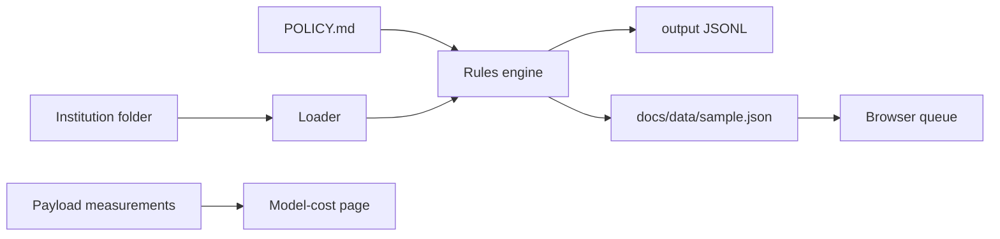
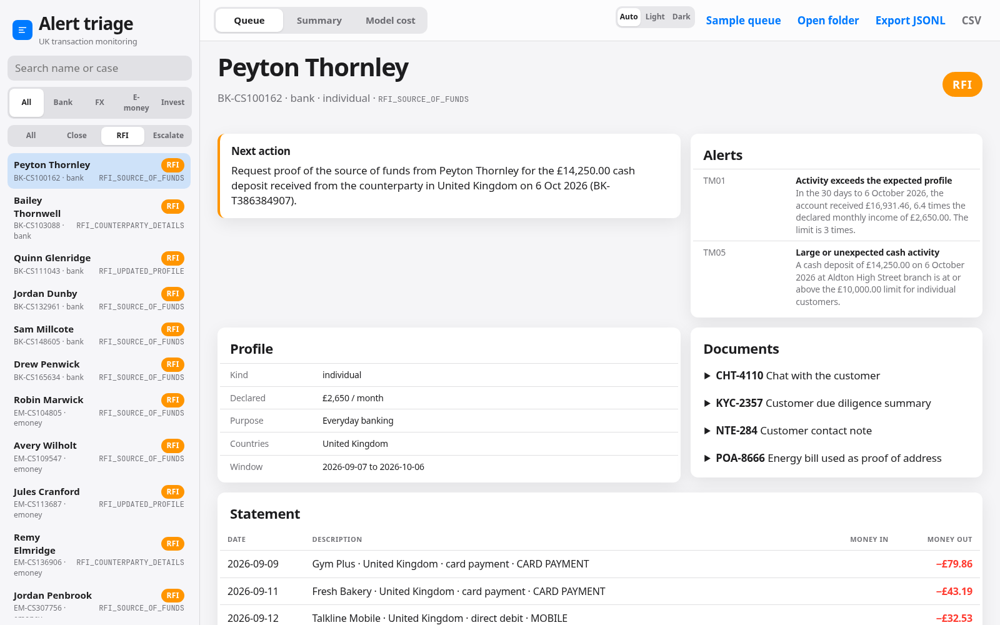
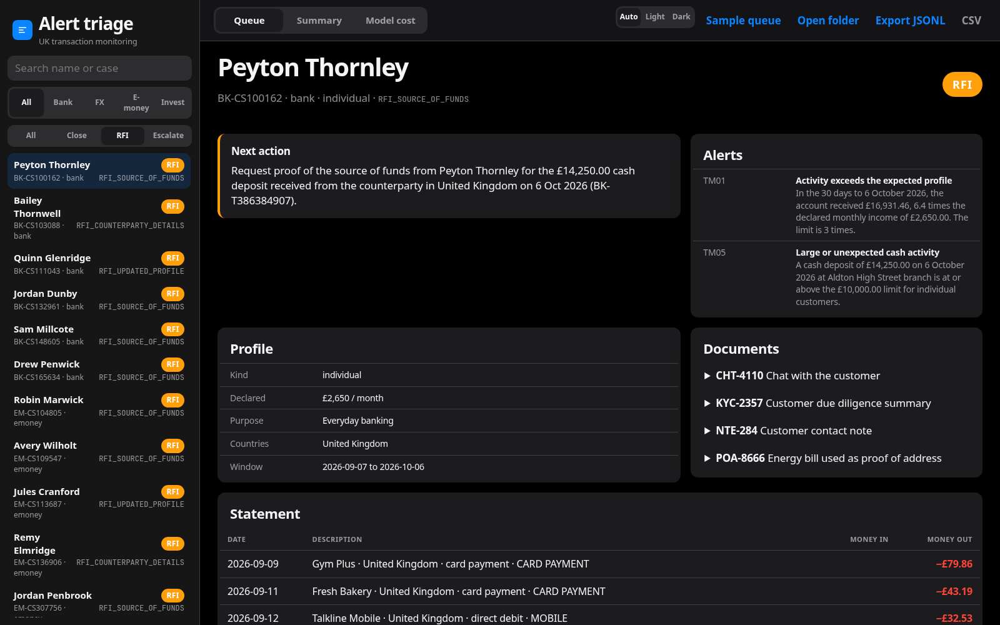
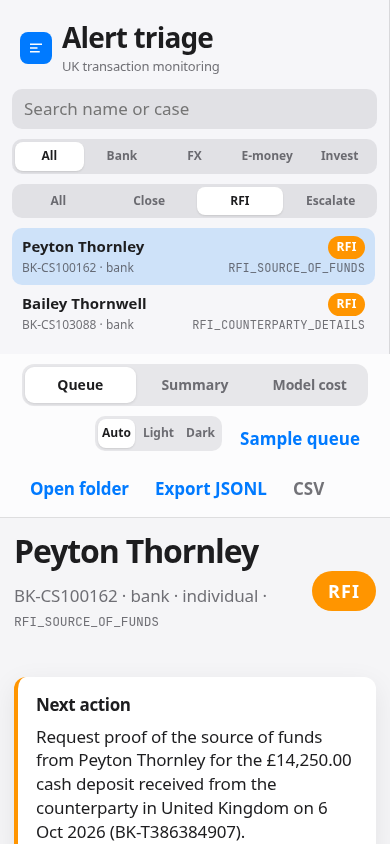
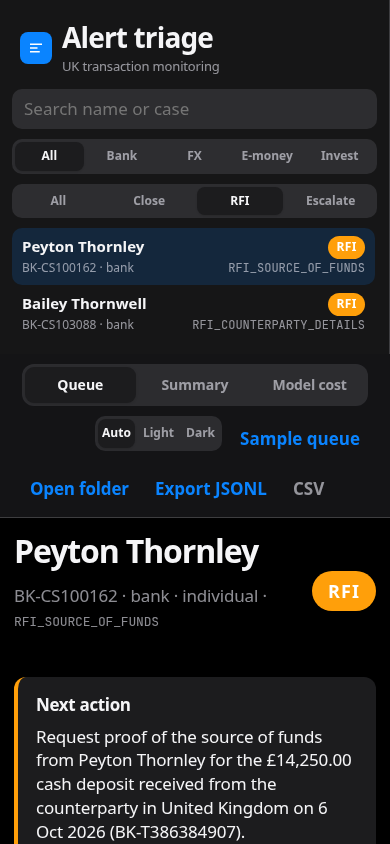
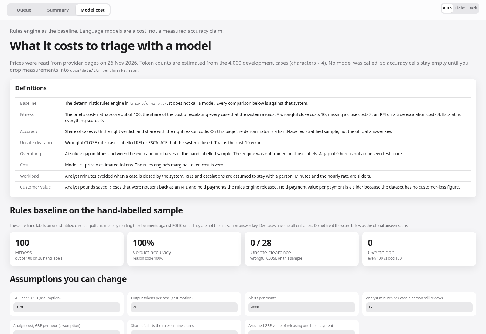
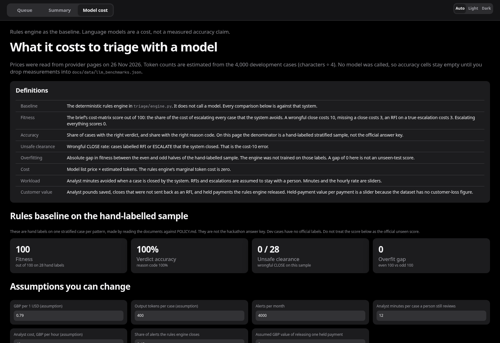
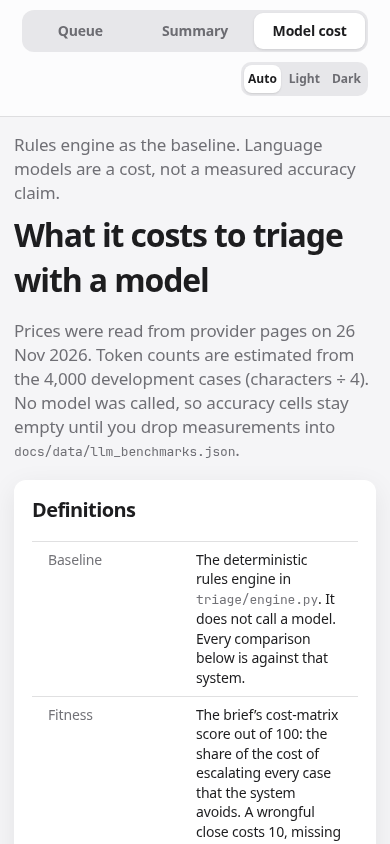
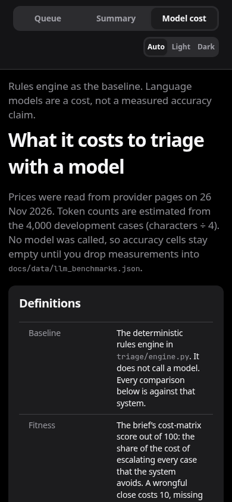

# Alert triage

A deterministic system that reads a folder of UK transaction-monitoring alerts and writes one verdict for every case: **CLOSE**, **RFI** or **ESCALATE**, with a reason code, a reason that names the case's own facts, and the document, transaction or list ids it relied on.

The development data for the [TM hackathon](https://hosted-pages.godiligent.ai/hackathon-tm-track/) is in `institutions/`. `BRIEF.html` is the brief. Amounts are in pounds.

Browser app, if GitHub Pages is enabled: <https://kehoekatherine.github.io/fintec-alert-triage/>

The queue is the case reviewer. [Model cost](docs/dashboard.html) is a second page: what it would cost to send the same cases through four published model APIs, next to this rules engine.

## Run the scored system

Python 3.11+ standard library only. From the repository root:

```bash
system/run institutions/bank output/bank.jsonl
system/run institutions/emoney output/emoney.jsonl
system/run institutions/investment output/investment.jsonl
system/run institutions/payments_fx output/payments_fx.jsonl
```

The same command works from inside `system/` with absolute paths, which is how the harness calls it:

```bash
cd system && ./run /absolute/path/to/bank /absolute/path/to/bank.jsonl
```

Equivalent module form, from the repository root:

```bash
python3 -m triage --cases institutions/bank --out output/bank.jsonl --stats
```

`output/*.jsonl` in this repo is that command's result on the 4,000 development cases.

A run of 1,000 cases takes about a second after the files are read, and about 0.0003 seconds of decision time per case. Five repeated runs on the bank folder produced identical JSON. Token cost is zero. Two hundred cases sit far inside the 30-minute limit.

## Run the web app locally

```bash
python3 -m http.server 8000 --directory docs
```

Open <http://127.0.0.1:8000/>. The sample queue is a stratified slice of the real development cases, with verdicts from this rules engine. **Model cost** is `dashboard.html`. To load another institution folder, use **Open folder** and choose a directory that contains `cases.jsonl`. That path runs the browser port in `docs/engine.js`. The scored file is always `system/run`; the browser port follows the same severity order and is not a line-for-line copy.

## Architecture



`triage/loader.py` reads only the folder it is given. `triage/engine.py` turns each case into findings. Escalation beats RFI, and RFI beats close. A case closes only when every alert is explained. Evidence ids are filtered to ids that exist on that case.

## How a case is decided

The four policies differ. Limits below are taken from each `POLICY.md`.

| | Bank | Payments and FX | E-money | Investment |
|---|---|---|---|---|
| What a case is | One customer over the review window | One held outgoing payment, or one client for money coming in | One customer over the window | One customer over the window |
| TM01 | Inflows over 3× monthly income, or 2× monthly turnover | Funding over 2× the monthly share of expected annual volume | Same shape as the bank | Same shape as the bank |
| TM02 | 80% of £2,000+ out within 48 hours. Card spend is not "paid out" | Same, but the client's own funding does not count | Same as the bank | 80% withdrawn within 10 days and under 20% invested |
| TM03 | 3+ cash deposits of £9,000–£9,999.99 in 10 days | 3+ payments to one beneficiary in that band. £10,000+ needs an invoice | 4+ cash top-ups of £800–£999.99 in 10 days | Does not run |
| TM04 | More than 6 counterparties in 30 days | More than 25 beneficiaries in 30 days | More than 6 counterparties in 30 days | Does not run |
| TM05 | Cash of £10,000+ (individual) or £25,000+ (business) | No cash | Cash top-up of £1,000+ (individual) or £5,000+ (business) | No cash |
| TM06 | £5,000+ with an undeclared higher-risk country | Same | Same | Same |
| TM07 | £5,000+ after 180 dormant days | Same | Same | Same |
| TM08 | Does not run | Funding of £1,000+ from a holder name that is not the client | Does not run | Deposit or withdrawal of £1,000+ with a holder name that is not the customer |
| TM10 | Does not run | Does not run | Does not run | Fund units sold within 90 days |
| TM22 | Payer, recipient or officer on the internal list | Beneficiary or officer | Payer or recipient | Who deposits the money |

Shared settings from the policies:

- Higher-risk countries as of 1 October 2026 are listed in each `POLICY.md` (Afghanistan through Yemen). An unexplained payment on that corridor is escalated, not sent back to the customer.
- A match on one list detail is not identity. A differing date of birth or a register that shows someone else closes as `LIST_MATCH_DIFFERENT_PARTY`. If the listed party still controls the counterparty, the case is `ESC_LISTED_PARTY`.
- Own-account transfers count only when a statement or letter shows the customer holds the other account. At five times declared income or volume or more, the verdict is `RFI_UPDATED_PROFILE`. Below that, `OWN_ACCOUNT`.
- An earlier review covers only what it describes. These notes are not used to close a larger new amount.
- Round amounts, a shared device, a new payee and crypto or gambling merchants are context. A device logged into several customer accounts is `ESC_ACCOUNT_MISUSE`. A fraud report or an admission that the account passes on other people's money is `ESC_MULE_ACTIVITY`.
- At the payments firm, £10,000 or more to anyone but the client needs a matching invoice or contract before a close can release it.

Suspicion is decided before any request for documents. The reason for an escalation does not tell the customer which question to answer.

## Reason codes

The codes are exactly the table in the brief and in each `POLICY.md`. Close codes name the document that explains the activity (`INVOICE_MATCHES`, `DOCUMENTED_EVENT`, `BUSINESS_RECORDS_RECONCILE`, `COLLECTION_DOCUMENTED`, `OWN_ACCOUNT`, `GROUP_COMPANY`, `THIRD_PARTY_DOCUMENTED`, `REFUND_OF_EARLIER_PAYMENT`, `RETURNING_CUSTOMER`, `LIST_MATCH_DIFFERENT_PARTY`, `WITHIN_PROFILE`). RFI codes name the single thing to ask for. Escalation codes name the suspicion.

## Input and output

Each institution folder:

| File | Role |
|---|---|
| `POLICY.md` | SOP, including the higher-risk country list and the five-times own-account rule |
| `cases.jsonl` | Case id, customer, review window, alert ids, held payment |
| `alerts.jsonl` | Rule id, measured values, transaction ids |
| `customers.jsonl` | Kind, name, declared income or turnover, countries |
| `transactions.jsonl` | Amount in GBP, direction, channel, counterparty, country |
| `evidence.jsonl` and `evidence/*.md` | Documents on file |
| `previous_reviews.jsonl` | Earlier reviews |
| `internal_list.jsonl` | Internal list entries |

One output line:

```json
{"case_id": "...", "alert_ids": ["..."], "verdict": "CLOSE", "reason_code": "INVOICE_MATCHES", "reason": "Two to four sentences naming the people, amounts and documents.", "evidence": ["INV-1", "TX-1"]}
```

A case missing from the file counts as an escalation. This system writes every case. Each line also has `action`: what the analyst should do next. For an RFI it names the document, the customer and the transaction. For an escalation it says to send the case to the MLRO, lists the evidence ids, and says not to contact the customer. A close says there is no further action, and a held payment at the payments firm is either released or kept held.

## Determinism and safety

Sorting and templates are fixed. There is no random sampling and no network call on the default path. The optional `--llm` flag calls OpenRouter at temperature 0 and caches under `system/.cache`. It cannot turn an escalation into an RFI or a close, or an RFI into a close. Leave it off for a scored run.

Development-case ids, names and amounts are not written into `triage/`. The tests check that.

## Scoring

The cost matrix, with the right verdict down the side and the system's verdict across:

| Right \ sent | CLOSE | RFI | ESCALATE |
|---|---:|---:|---:|
| CLOSE | 0 | 3 | 3 |
| RFI | 10 | 0 | 2 |
| ESCALATE | 10 | 3 | 0 |

Fitness on this page is the share of the escalate-everything cost that the system avoids, from 0 to 100. Escalating everything scores 0. A wrongful close is the expensive mistake.

The development cases have **no official labels**. The number on the model-cost page is a proxy: 28 patterns, one real case each, labelled by reading the documents against `POLICY.md`. On that sample the engine agrees with every label, including zero wrongful closes. That is not the score on the 800 unseen cases. The labels, the notes, and the even/odd split are in `docs/data/hand_labels.json`.

```bash
python3 -m pytest -q
python3 -m triage.score --expected docs/data/hand_labels.json --predicted /tmp/predicted.jsonl
```

`triage.score` reads a JSONL of expected verdicts. The hand-label file is a JSON object, so the pytest suite scores it directly.

## Model cost

`docs/dashboard.html` compares the rules engine with four published APIs, checked 26 Nov 2026:

| Model | Input / 1M | Output / 1M | Source |
|---|---:|---:|---|
| GPT-4o | $2.50 | $10.00 | [OpenAI pricing](https://developers.openai.com/api/docs/pricing) |
| Claude Sonnet 5.5 | $2.00 | $10.00 | [Anthropic pricing](https://platform.claude.com/docs/en/about-claude/pricing) |
| Gemini 3.8 Flash | $0.75 | $3.75 | [Gemini pricing](https://ai.google.dev/gemini-api/docs/pricing) through 31 Dec 2026, then $1.50 / $7.50 |
| Llama 3.3 70B on Groq | $0.59 | $0.79 | [Groq on-demand pricing](https://home.cloud.groq.io/pricing), published speed 394 tokens/sec |

Input size is measured, not guessed: the customer, the alerts, the transactions inside the review window, and the evidence markdown. Mean length is about 9,300 characters, which is about **2,265 tokens** at four characters per token. That divisor is an estimate, not a provider tokenizer. Rules-engine reasons are about 90 tokens. The dashboard's default of 400 output tokens is a separate assumption for a short JSON answer, and the sliders recompute cost, a month of volume, analyst time, and the 200-case clock against 30 minutes.

No model was called. Accuracy cells for the four models stay empty. Put a real run in `docs/data/llm_benchmarks.json` under a model's `measured` object (`verdict_accuracy`, and optionally `reason_accuracy` and `unsafe_clearance`) and reload the page.

Groq's price is hosted inference of open weights. It is not a self-hosted GPU bill. GPT-4o's own model page lists that snapshot as deprecated; the price list still publishes the rates above.

## Tests

```bash
python3 -m pytest -q
```

The suite checks the cost matrix, that every development case is present, that every cited evidence id exists, that reason codes belong to the verdict, that five bank runs match, and that the hand labels agree with the engine.

Regenerate the browser bundle after an engine change:

```bash
PYTHONPATH=. python3 scripts/build_site_data.py
```

## Screenshots

Wide desktop and a phone-width view, light and dark. The case page is a statement plus a next-action card. `action` is an extra field on each output line, after the fields the harness requires.

















## Pages

`.github/workflows/pages.yml` publishes the `docs/` directory. The site URL above works after the repository's Pages source is set to GitHub Actions. If the URL 404s, that switch has not been turned on: **Settings → Pages → Build and deployment → Source: GitHub Actions**.

No file in the data set is over GitHub's 100 MB limit. The largest file is the bank transactions extract, about 29 MB, so Git LFS is not used.

## Limitations

- Official labels do not exist here. The fitness number is the 28-case hand sample only.
- The browser port used when you open a folder is not identical to `system/run` on every edge case.
- A chat message from the customer does not, by itself, close a case. Some true closes that rest only on a credible conversation will be an RFI or an escalation instead. That is the conservative side of the cost matrix.
- Prior-review notes are not treated as covering a new amount.
- Gemini's Flash price on the page is the rate Google publishes through 31 Dec 2026.

## Licence

[MIT](LICENSE).
